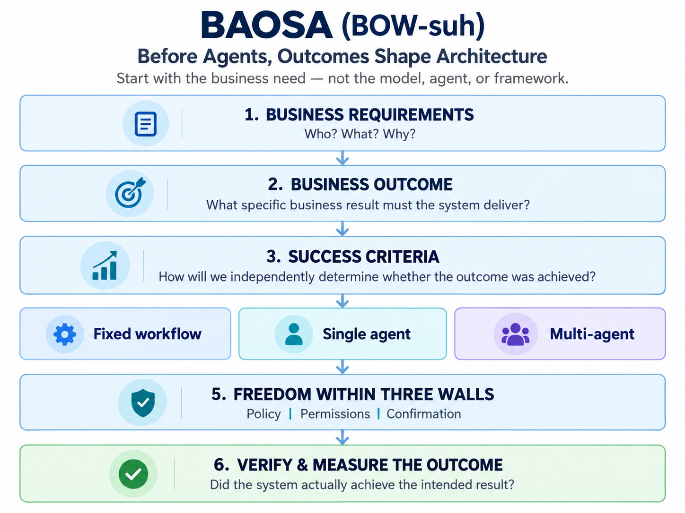
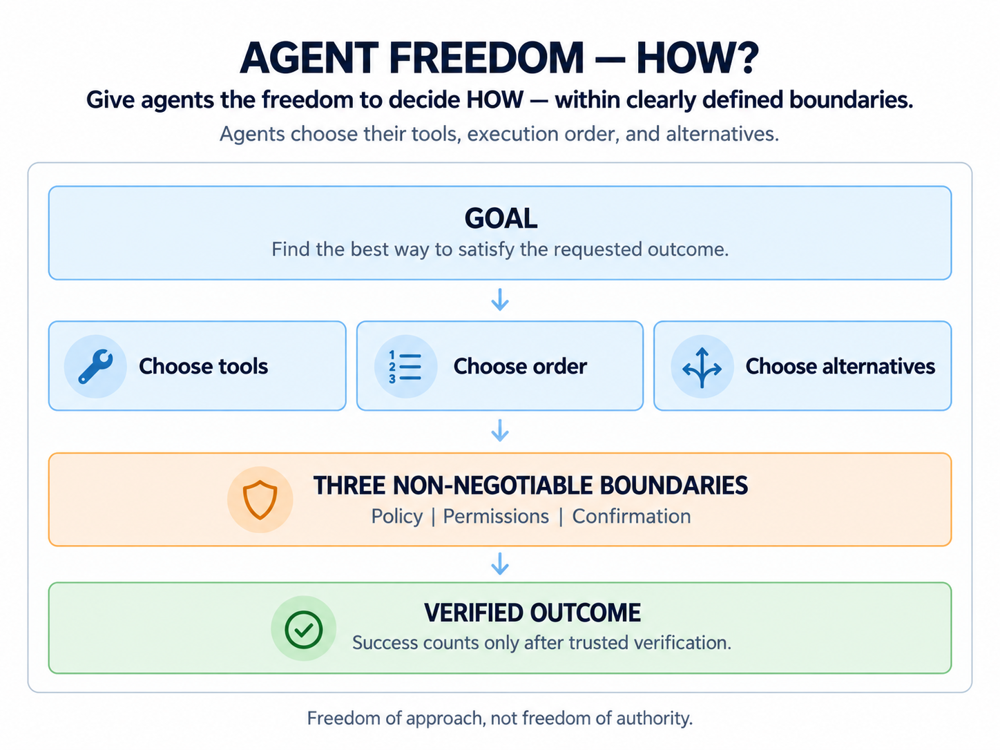
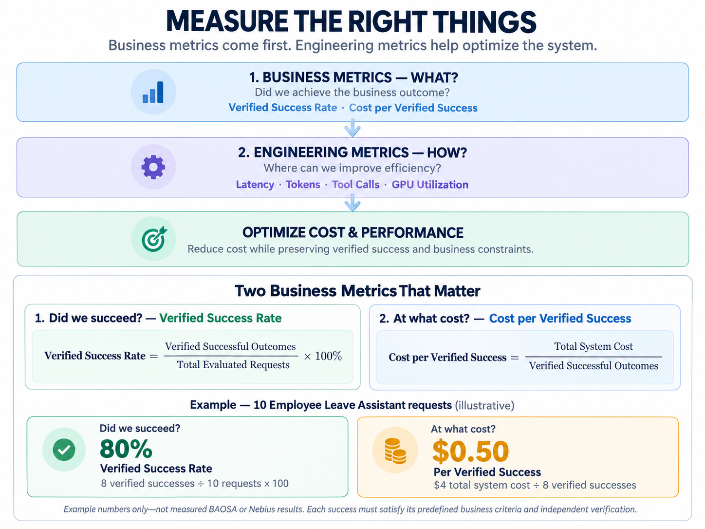

# BAOSA

**Pronounced “BOW-suh”** · **Before Agents, Outcomes Shape Architecture**\
**An Outcome-First AI Engineering Methodology** · **Created by Santosh Kumar**

**Define Success. Build Simply. Verify Outcomes.**

### What if the best way to build an AI agent is not to build one?

AI development often begins with technology questions:

**Which model? Which inference platform? Which agent framework?**

**BAOSA begins with a different question:**

**What business problem are we solving, and what outcome must we deliver?**

Understand the **business requirements**. Define the **business outcome** and **success criteria**. *Then* choose the technology and architecture that can deliver it.

## The BAOSA Philosophy

**Give agents the freedom to decide HOW—within clearly defined boundaries.** Agents choose their permitted tools, execution order, and alternatives.

**Three non-negotiable boundaries: Policy · Permissions · Confirmation.** Trusted application code enforces them throughout execution.

## Agent Freedom — HOW?

**Freedom of approach. Not freedom of authority.**

## Two Business Metrics That Matter

*Example numbers only—not measured BAOSA or Nebius results. Each success must satisfy its predefined business criteria and independent verification.*

**Measure verified business outcomes—not how many agents, tokens, or tool calls the system uses.** [How success and cost are defined →](docs/METHODOLOGY-AND-OUTCOMES.md)

## One Simple Example — Employee Leave Assistant

| | What happened? | Independent verification |
|---|---|---|
| ✅ **Success** | Leave request submitted. | **Saved record exists and matches the request.** |
| ❌ **Failure** | Agent says “Submitted!” | **No saved record exists.** No verified success. |

**BAOSA verifies what happened—not what the agent claimed.** [See both workflow and agent modes →](docs/DEMO.md)

## Measure WHAT. Optimize HOW.

**Business metrics establish WHAT we achieved. Engineering metrics explain HOW to improve delivery.** The current demo focuses on verified business outcomes; engineering benchmarks are future work. [Measurement guide →](docs/BUSINESS-AND-ENGINEERING-METRICS.md)

## Go Deeper

| Explore | Read |
|---|---|
| **Principle, methodology, and both formulas** | [Methodology & Outcomes](docs/METHODOLOGY-AND-OUTCOMES.md) |
| **FREELY HOW and the three trusted walls** | [Agent Freedom & Boundaries](docs/AGENT-FREEDOM-AND-BOUNDARIES.md) |
| **SLI, SLO, SLA — what each means and when it matters** | [Service Levels](docs/SERVICE-LEVELS.md) · [Original Requirements](docs/ORIGINAL-REQUIREMENTS.pdf) |
| **Why Nebius Token Factory? Why Reflection AI Beam?** | [Engineering Decisions](docs/DECISIONS.md) |
| **Run fixed workflow or agent; Mock or optional Live Mode** | [Run Locally](docs/RUN-LOCALLY.md) · [Demo Walkthrough](docs/DEMO.md) |
| **Python methods, architecture, and optional tests** | [Source Code Guide](docs/SOURCE-CODE-GUIDE.md) · [Tests](docs/TESTING.md) |
| **All editable diagrams and complete documentation** | [Diagrams](docs/DIAGRAMS.md) · [Documentation Index](docs/README.md) |

The demo features **Nebius Token Factory** as a managed inference option and **Reflection AI Beam** as an initial reasoning/tool-calling model candidate. The offline simulator does **not** run Beam; actual Live Mode inference and model benchmarks remain to be validated. [Read why we chose each →](docs/DECISIONS.md)

## What BAOSA Is — and What It Is Not

**BAOSA is an outcome-first AI engineering methodology—not an agent orchestration framework.** It does not require a particular model, inference provider, framework, or number of agents.

**The business outcome shapes the architecture. Independent evidence establishes success.**

*Created by Santosh Kumar · MIT License · Educational quickstart with fictional, in-memory HR data.*
