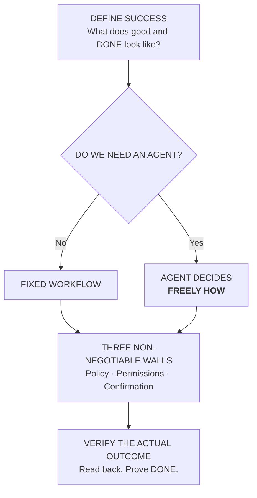

# BAOSA — The 30-second philosophy

**Before Agents, Outcomes Shape Architecture** · **Author: Santosh Kumar**\
*Define Success. Build Simply. Verify Outcomes.*

> **What if the first decision in building an AI agent is whether you need one at all?**

**Freedom of approach. Not freedom of authority.**

- **Policy:** The agent cannot override business rules.
- **Permissions:** The agent cannot exceed the actor's authorized scope.
- **Confirmation:** The agent cannot commit an action without explicit approval of the exact proposal.

[Full README](../README.md) · [Why the walls exist](AGENT-FREEDOM-AND-BOUNDARIES.md)

**BAOSA is an engineering methodology, not an agent orchestration framework.** [Measurement mantra and verified resolutions](METHODOLOGY-AND-OUTCOMES.md).
