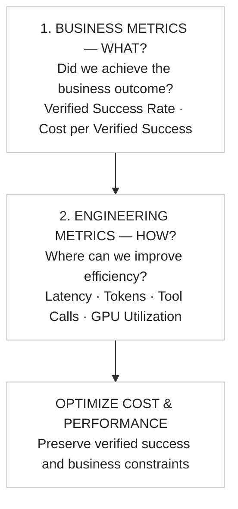

# BAOSA measurement — WHAT first, HOW second

**Author:** Santosh Kumar · [← Methodology](METHODOLOGY-AND-OUTCOMES.md) · [← README](../README.md)

## Measure the right things

**Business metrics establish whether we delivered value. Engineering metrics explain the behavior and guide optimization.** The order is a *decision-making priority*, not a rule to delay capturing telemetry.

## The business formulas

**Verified Success Rate — did we succeed?**

$$
\frac{\text{Verified Successful Outcomes}}{\text{Total Evaluated Requests}} \times 100\%
$$

**Cost per Verified Success — at what cost?**

$$
\frac{\text{Total System Cost}}{\text{Verified Successful Outcomes}}
$$

For both metrics, first define which outcomes count as correct for the chosen business goal. A successful leave-request **submission** differs from manager **approval**. A valid refusal may count as a correct **resolution** but not as fulfilled leave. Never mix these denominators without an explicit definition.

## A tiny example (illustrative, not measured)

| Inputs | Value |
|---|---:|
| Evaluated requests | 10 |
| Independently verified successful resolutions | 8 |
| Total system cost | $4 |
| **Verified Success Rate** | **80%** |
| **Cost per Verified Success** | **$0.50** |

Do not treat hypothetical dollars as Nebius pricing. No code in this quickstart currently aggregates measured total system cost over a request cohort, and mock inference produces **no actual tokens or provider usage**.

## Where engineering metrics help later

| Engineering diagnostic | The question it helps answer |
|---|---|
| P50/P95 end-to-end latency | Are users waiting too long? |
| TTFT / TPOT | Is generation start or ongoing decoding slow? |
| Tokens and model calls | Are we using unnecessary inference work? |
| Tool calls, failures, retries | Is agent execution inefficient or fragile? |
| Queue depth, batch size, KV-cache, GPU utilization | Is serving capacity used effectively? |

**Do not optimize tokens or GPU utilization at the expense of verified business success.** A faster, cheaper system that violates a business rule is not a successful implementation. [Service-level targets vs actual measurements →](SERVICE-LEVELS.md).
