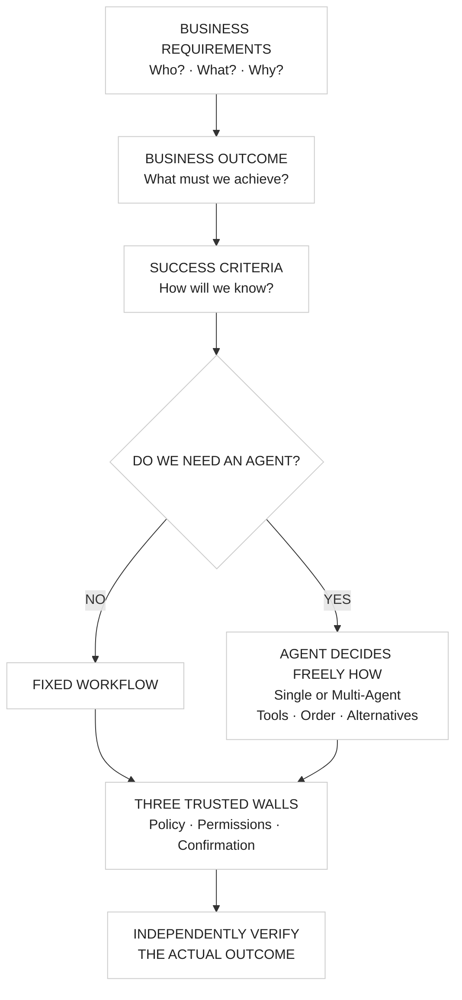
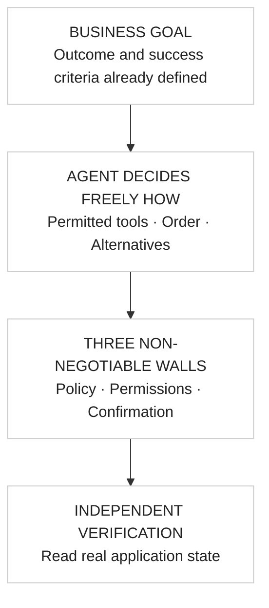
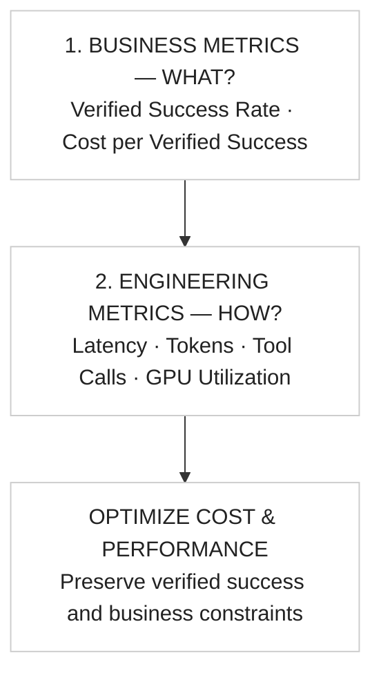

# BAOSA diagrams — approved visuals and editable engineering reference

**Author:** Santosh Kumar · [← README](../README.md)

**These three reference images are the approved visual design used by the GitHub README.** They are intentionally identical to the original images; do not replace them with Mermaid renderings.

## Approved diagram 1 — BAOSA methodology

## Approved diagram 2 — Agent freedom

## Approved diagram 3 — Business metrics before engineering metrics

---

## Supplemental editable Mermaid sketches

The following Mermaid flows are technical sketches for editing and exploration. **They are not pixel-identical to the three approved images above.** The approved images and the root README are the visual references.

## 1. Before Agents — outcomes shape the choice

The **No** path has no agent autonomy; the **Yes** path gives agent(s) freedom to choose their permitted execution approach. **Both** paths have relevant business controls, which trusted code applies **throughout execution**. [What is BAOSA? →](METHODOLOGY-AND-OUTCOMES.md).

## 2. Agent autonomy — freedom of approach, not authority

The walls are **trusted application checks**, not a fixed sequence that the model must follow. The model may propose; it cannot make an unauthorized submission. [How it's enforced →](AGENT-FREEDOM-AND-BOUNDARIES.md).

## 3. Measure WHAT. Optimize HOW.

[Business formulas and measurement limitations →](BUSINESS-AND-ENGINEERING-METRICS.md).
